# Laundrymart Platform

A high-performance Django-based platform for laundry pickup, washing, and delivery services, integrated with **Uber Direct** for automated courier logistics and **Stripe Connect** for pre-authorizations, customer card payments, and instant vendor payouts.

---

## Architecture & Module Directory

The system is decomposed into 7 specialized modules, each documented in detail within its respective directory:

| Module | Documentation | Key Responsibilities |
|---|---|---|
| **Accounts** | [accounts/README.md](file:///home/arnob/ongoing_projects/Laundrymart/accounts/README.md) | User authentication (Email/Phone + OTP, Firebase), store profile setup, staff 2FA, secondary addresses. |
| **Customer** | [customer/README.md](file:///home/arnob/ongoing_projects/Laundrymart/customer/README.md) | Store discovery, automated cheapest store selection, order tracking, reviews, auto-reassignment engine. |
| **Vendor** | [vendor/README.md](file:///home/arnob/ongoing_projects/Laundrymart/vendor/README.md) | Order offer acceptance/rejection, weighing and pricing, laundry status transitions, order completion task. |
| **Payment** | [payment/README.md](file:///home/arnob/ongoing_projects/Laundrymart/payment/README.md) | Saved payment methods, pre-authorization holds, order progression milestones, Stripe Connect payouts. |
| **Uber** | [uber/README.md](file:///home/arnob/ongoing_projects/Laundrymart/uber/README.md) | Uber Direct API integration, dynamic quote generation, courier dispatch, webhook event ingestion. |
| **Messaging** | [messaging/README.md](file:///home/arnob/ongoing_projects/Laundrymart/messaging/README.md) | Live WebSocket chat (Django Channels/Daphne), support rooms, in-app notifications, FCM push alerts. |
| **Admin Panel** | [admin_panel/README.md](file:///home/arnob/ongoing_projects/Laundrymart/admin_panel/README.md) | Singleton CMS configuration, dynamic fee structures, slider banners, templates, platform analytics. |

---

## Core Order & Delivery Lifecycle

```mermaid
sequenceDiagram
    autonumber
    actor Customer
    participant API as Customer API
    participant Payment as Payment & Celery
    actor Vendor
    participant Uber as Uber Direct API

    Customer->>API: 1. Request Quote (drop_off / pickup / full_service)
    API->>Uber: Create pickup/delivery quote
    Customer->>Payment: 2. Confirm order & validate card (Pre-authorization hold)
    Payment->>Vendor: 3. Offer order to nearest vendor (9-min window)
    
    alt Vendor Accepts (or Auto-Accept Enabled)
        Vendor->>Payment: Accept Quote
        Payment->>Payment: Create Order & Progression steps
        Payment->>Uber: Schedule Pickup Courier
        Uber-->>Vendor: Courier delivers laundry to store
        Vendor->>API: Mark as received & submit actual weight
        Vendor->>API: Mark as ready
        Payment->>Payment: Background Task: Charge final total & Payout vendor
        Payment->>Uber: Schedule Return Courier to Customer
        Uber-->>Customer: Laundry delivered
    else Vendor Declines or Times Out (8 mins)
        Payment->>Payment: Celery Task: auto_assign_another_laundrymart
        Payment->>Payment: Re-assign to next open store within 10 miles
    end
```

---

## Technology Stack

* **Backend Framework**: Django 5.2, Django REST Framework
* **Real-time Server**: Django Channels, Daphne (ASGI)
* **Asynchronous Task Queue**: Celery with Redis broker and result backend
* **Logistics Engine**: Uber Direct Delivery API (REST + Webhooks)
* **Payment Engine**: Stripe API, Stripe Connect, Stripe Embedded Components
* **Authentication**: SimpleJWT, Firebase Admin SDK, OTP (Email + Twilio SMS)
* **Database**: PostgreSQL / SQLite (Development)
* **Cache & Channel Layer**: Redis
* **API Documentation**: OpenAPI 3.0 via `drf-spectacular` (Swagger UI at `/api/schema/swagger-ui/`)
