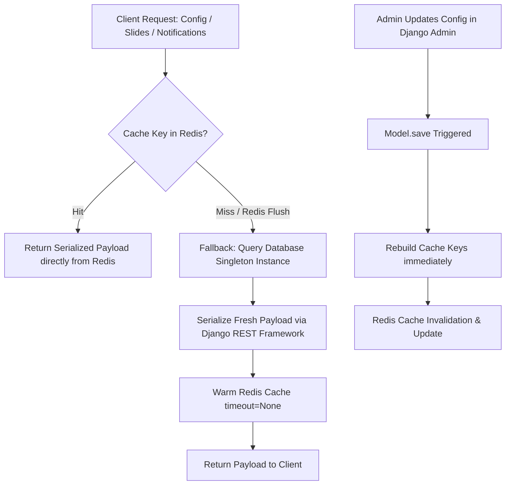

# Admin Panel Module Documentation

The `admin_panel` module provides configuration management, dynamic CMS content, fee structures, banner sliders, templated notification messages, and super admin analytics reporting across the entire LaundryMart platform.

---

## 1. Database Tables & Models

| Model Name | Database Table | Description |
|---|---|---|
| `GlobalManifest` | `admin_panel_globalmanifest` | Singleton configuration model (via `django-solo`) housing global settings: platform fee percentage, Stripe processing charge percentages and fixed cents, insurance fees, bag sizes and photos, customer and vendor FAQs, privacy policies, terms of service, and referral credit settings. |
| `NotificationText` | `admin_panel_notificationtext` | Singleton model storing all customer and vendor notification templates with dynamic placeholder formatting (e.g. `{vendor_name}`, `{date}`, `{time}`, `{weight}`). |
| `SlideImage` | `admin_panel_slideimage` | Carousel slider images displayed in customer mobile and web apps, sorted by `order_index`. |
| `AdminDashboard` | `admin_panel_admindashboard` | Django Admin model marker for the custom Unfold super admin dashboard. |

---

## 2. API Endpoints

Mounted under `/admin-panel/api/`.

### 2.1 Super Admin Statistics

#### `GET /admin-panel/api/super-admin-stats/`
* **Handler**: `super_admin_stats_api`
* **Permissions**: Staff / Super Admin
* **Description**: Aggregates business health metrics for a chosen date range and optional vendor filter. Computes platform net revenue, insurance volume, average laundry fees per pound, completed order count, and total weight processed.
* **DB Tables Used**:
  * `payment_order` (Read, Aggregates: `Sum('insurance_amount')`, `Sum('weight_in_pounds')`, `Count('id')`, `Sum('service_charge_cents')`)
  * `payment_vendorpayout` (Read, Aggregates: `Sum('platform_fee')`, `Sum('amount')`, `Sum('added_stripe_fee')`)
  * `accounts_laundrymartstore` (Read)
* **Query Parameters**:
  * `start_date` (string, `YYYY-MM-DD`, optional): Start date filter (defaults to today).
  * `end_date` (string, `YYYY-MM-DD`, optional): End date filter (defaults to today).
  * `vendor_id` (integer, optional): Scope calculations to an individual laundromat store.
* **Response Body**:
  ```json
  {
    "revenue": 1450.50,
    "insurance": 220.00,
    "vendor_fee_per_lb": 2.25,
    "platform_fee": 1450.50,
    "total_orders": 85,
    "total_weight": 1420.5,
    "start_date": "2026-09-01",
    "end_date": "2026-09-24",
    "vendor_id": null
  }
  ```

---

## 3. High-Performance Caching & Fallback Architecture

To ensure sub-millisecond API response times for app startup and order calculation, `admin_panel` models maintain a warm Redis cache layer with robust fallback logic:



### Managed Cache Keys
* `customer_global_manifest_data`: Full customer config payload including bag pricing and app text.
* `vendor_global_manifest_data`: Vendor platform terms and charge configurations.
* `notification_text_data`: Templated notification strings.
* `slide_image_data`: List of promotional carousel images with absolute URLs.

### Invalidation & Fallback Guarantee
1. **Immediate Propagation**: When an administrator saves or deletes records in `GlobalManifest` or `SlideImage`, the `save()` and `delete()` hooks immediately regenerate the serialized JSON and execute `cache.set(key, data, timeout=None)`.
2. **Resilience to Cache Loss**: If Redis is restarted or cleared, `get_customer_cached_config()`, `get_vendor_cached_config()`, `get_cached_notification_text()`, and `get_cached_slide_images()` intercept cache misses, fetch directly from SQL tables, re-warm Redis, and proceed without request failures.
