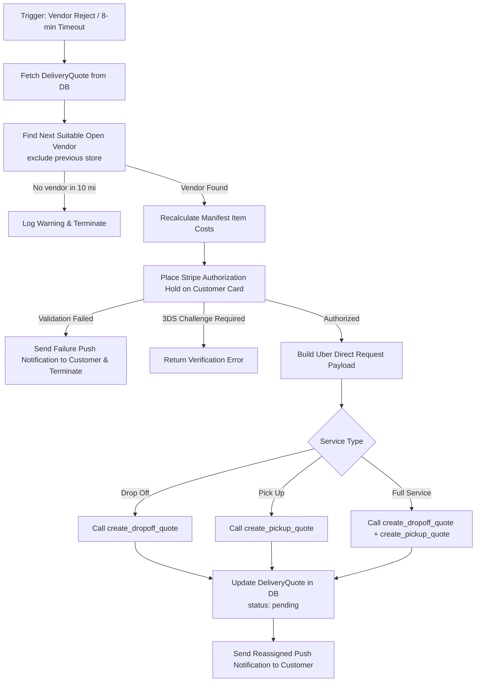

# Customer Module Documentation

The `customer` module manages the customer experience: discovering and filtering nearby laundry stores, automatic cheapest-store selection, quote creation, order validation, active and historical order tracking with real-time progression milestones, issue reporting, ratings/reviews, and the automated vendor re-assignment engine.

---

## 1. Database Tables & Models

| Model Name | Database Table | Description |
|---|---|---|
| `Review` | `customer_review` | Stores customer ratings (1 to 5 stars) and comments left for a specific `LaundrymartStore`. Updates store average rating. |
| `OrderReport` | `customer_orderreport` | Customer-filed dispute or complaint regarding an order or delivery logistics, linked one-to-one with `Order` or `DeliveryQuote`. |
| `OrderReportImage` | `customer_orderreportimage` | Supporting photographic evidence attached to customer issue reports. |
| `OutOfServiceCustomers` | `customer_outofservicecustomers` | Tracks customer coordinates when they search for stores in unserviceable areas, aiding market expansion analysis. |

### Related Models Queried / Modified by Customer APIs
* `accounts_user` (`User`) - Customer profiles and preferences.
* `accounts_laundrymartstore` (`LaundrymartStore`) - Store locations, pricing, operating hours.
* `payment_order` (`Order`) - Laundry orders, pricing, statuses, addresses, timestamps.
* `payment_orderprogression` (`OrderProgression`) - Step-by-step progress checklist for orders.
* `uber_deliveryquote` (`DeliveryQuote`) - Quotes created for Uber courier pickup/delivery.
* `uber_delivery` (`Delivery`) - Uber logistics tracking.
* `admin_panel_globalmanifest` (`GlobalManifest`) - Bag pricing, app copy, terms.

---

## 2. API Endpoints

All customer endpoints are mounted under `/customers/api/`.

### 2.1 Vendor Discovery & Store Selection

#### `GET /customers/api/vendors`
* **Handler**: `VendorAPIView`
* **Permissions**: `IsCustomer`
* **Description**: Lists nearby active laundry stores within a serviceable radius, calculated from SQL Haversine distance formula. Supports filtering, searching by store name or address, and ordering by distance, Google rating, or price per pound. If no stores are in range, records the customer's coordinates in `OutOfServiceCustomers` for future service analysis.
* **DB Tables Used**:
  * `accounts_laundrymartstore` (Read)
  * `customer_outofservicecustomers` (Insert when no vendors found)
* **Query Parameters**:
  * `lat` (float, optional): Latitude to calculate distance (defaults to profile latitude).
  * `lng` (float, optional): Longitude to calculate distance (defaults to profile longitude).
  * `ordering` (string, optional): Sort by `distance`, `google_rating`, or `price_per_pound` (prefix with `-` for descending).
* **Response**: Paginated list of vendor objects with current open/closed status, operating hours, and distance in miles.

#### `GET /customers/api/choose-for-customer`
* **Handler**: `ChooseForCustomer`
* **Permissions**: `IsCustomer`
* **Description**: Automatically evaluates and selects the single cheapest open `LaundrymartStore` within a 10-mile radius of the customer's saved profile coordinates (`user.lat`, `user.lng`). It verifies active Stripe Connect status and filters out stores currently closed according to the day's operating hours.
* **DB Tables Used**:
  * `accounts_laundrymartstore` (Read)
  * `accounts_user` (Read)
* **Response**: `200 OK` with store profile, price per pound, distance, and today's operating hours.

---

### 2.2 Quotes & Order Placement Flow

#### `POST /customers/api/get-quote`
* **Handler**: `UberCreateQuoteAPIView` (from `uber.views`)
* **Permissions**: `IsCustomer`
* **Description**: Generates an initial delivery quote with Uber Direct for the selected service type (`drop_off`, `pickup`, or `full_service`).
* **DB Tables Used**:
  * `uber_deliveryquote` (Insert)
  * `uber_manifestitem` (Insert)
* **Request Body**:
  ```json
  {
    "service_type": "full_service",
    "pickup_address": "123 Main St, New York, NY",
    "dropoff_address": "456 Broadway, New York, NY",
    "pickup_latitude": 40.7128,
    "pickup_longitude": -74.0060,
    "dropoff_latitude": 40.7200,
    "dropoff_longitude": -74.0100,
    "pickup_phone_number": "+1234567890",
    "dropoff_phone_number": "+1987654321",
    "pickup_ready_dt": "2026-09-25T14:00:00Z",
    "external_store_id": "3fa85f64-5717-4562-b3fc-2c963f66afa6",
    "customer_note": "Handle delicates with care",
    "manifest_items": [
      {
        "name": "Medium Bag",
        "quantity": 2,
        "size": "medium",
        "weight": 15.0,
        "price": 30.00
      }
    ]
  }
  ```

#### `POST /customers/api/confirm-order`
* **Handler**: `ConfirmOrderAPIView` (from `payment.views`)
* **Permissions**: `IsCustomer`
* **Description**: Persists the delivery quote in `draft` status, ensures the customer has a Stripe customer account, and returns any saved payment cards on file.
* **DB Tables Used**:
  * `uber_deliveryquote` (Insert/Update)
  * `accounts_user` (Read, Update Stripe Customer ID)

#### `POST /customers/api/charge-by-card`
* **Handler**: `validate_saved_method` (from `payment.views`)
* **Permissions**: `IsCustomer`
* **Description**: Places an off-session authorization hold (`capture_method="manual"`) on the customer's selected card for the estimated total + 30% buffer. If authorization succeeds, transitions quote to `pending` and queues the background vendor acceptance task.
* **DB Tables Used**:
  * `uber_deliveryquote` (Read, Update status to `pending`, validation info)
* **Background Tasks Triggered**:
  * Schedules `payment.tasks.process_acceptance_by_vendor.apply_async(args=[pending_quote_id], countdown=3)`

---

### 2.3 Order Tracking & History

#### `GET /customers/api/order-history`
* **Handler**: `CustomerOrdersListAPIView`
* **Permissions**: `IsCustomer`
* **Description**: Returns paginated order history with filter options (`all`, `active`, `completed`, or `pending_quotes`). Returns full progression milestones and Uber tracking links.
* **DB Tables Used**:
  * `payment_order` (Read)
  * `payment_orderprogression` (Read)
  * `uber_deliveryquote` (Read)
  * `uber_manifestitem` (Read)
* **Query Parameters**:
  * `filter` (string): `active` | `completed` | `pending_quotes` | `all`

#### `GET /customers/api/order-detail/<int:id>`
* **Handler**: `customer_order_detail`
* **Permissions**: `IsCustomer`
* **Description**: Detailed status breakdown for an individual order or pending delivery quote, including courier live tracking URL, store opening hours, item manifests, final weight, and fees.
* **DB Tables Used**:
  * `payment_order` (Read)
  * `uber_deliveryquote` (Read)
  * `accounts_laundrymartstore` (Read)

---

### 2.4 Reviews & Problem Reporting

#### `POST` / `GET /customers/api/review/<int:pk>`
* **Handler**: `ReviewAPIView`
* **Permissions**: `IsCustomer`
* **Description**: Submits or lists ratings and reviews for store `<int:pk>` (`LaundrymartStore.id`). Validates rating between 1 and 5 stars.
* **DB Tables Used**:
  * `customer_review` (Insert, Read)
  * `accounts_laundrymartstore` (Read)

#### `POST /customers/api/order-report`
* **Handler**: `CustomerOrderReportAPIView`
* **Permissions**: `IsCustomer`
* **Description**: Allows customers to submit an issue description and multiple photographic attachments for an order or quote.
* **DB Tables Used**:
  * `customer_orderreport` (Insert)
  * `customer_orderreportimage` (Insert)
  * `payment_order` (Read)

#### `GET /customers/api/global-manifest`
* **Handler**: `CustomerGlobalManifestAPIView`
* **Permissions**: `AllowAny`
* **Description**: Fetches cached platform config (bag dimensions, pricing per bag, service fees, FAQs, terms, privacy policies, carousel slide images) from Redis cache.
* **DB Tables Used**:
  * Redis Cache (`customer_global_manifest_data`) with fallback to `admin_panel_globalmanifest` and `admin_panel_slideimage`.

---

## 3. Background Tasks & Fallback Logic

### Celery Task: `auto_assign_another_laundrymart`

* **Task Signature**: `auto_assign_another_laundrymart(quote: int, customer_id: str) -> dict`
* **File Location**: `customer/tasks.py`
* **Trigger Conditions**:
  1. **Vendor Rejection**: In `vendor.views.RejectQuoteAPIView`, when a vendor explicitly rejects a quote and the customer has setting `preference == "Auto-assign another LaundryMart (fastest)"`.
  2. **Acceptance Timeout**: In `payment.tasks.process_acceptance_by_vendor`, if the assigned vendor does not have `auto_accept_orders` enabled, a delayed task is scheduled with an 8-minute countdown (`countdown=480`).



#### Detailed Execution Steps & Fallback Logic:
1. **Find Replacement Vendor**: Calls `get_nearby_open_vendor(customer, excluded_mart_id=quote.external_store_id)` within 10 miles.
   * *Fallback*: If no open laundry store exists within range, aborts re-assignment and logs `"No available open laundry mart"`.
2. **Cost Recalculation**: Sums item weights from `ManifestItem` multiplied by new vendor's `price_per_pound` + `insurance_amount`.
3. **Payment Re-validation**: Creates an authorization hold for 130% + $10 buffer on customer's saved payment method.
   * *Fallback*: If payment hold fails, dispatches push notification `customer_recveive_payment_validation_failure_notification(quote.customer)` and aborts safely.
4. **Uber Direct Quote Generation**:
   * For `drop_off`: Requests dropoff quote from Uber Direct API.
   * For `pickup`: Requests pickup quote from Uber Direct API.
   * For `full_service`: Requests both legs and aggregates fees into `quote.fee`.
   * *Fallback*: Catches `requests.RequestException` and Uber error schemas. If Uber returns an error, leaves previous state intact and records error diagnostics.
5. **Database Atomic Commit**: Updates `DeliveryQuote.quote_id`, `external_store_id`, `fee`, `dropoff_eta`, and resets `status = 'pending'`, allowing the new vendor to receive the order offer.
