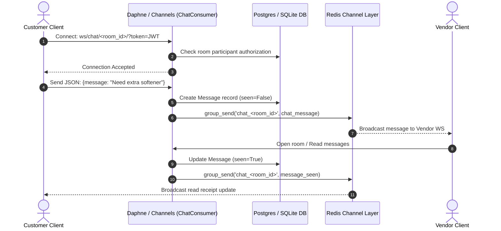

# Messaging Module Documentation

The `messaging` module powers real-time chat between customers, vendors, and support admins, as well as in-app notifications and Firebase Cloud Messaging (FCM) push alerts. It integrates Django REST Framework for HTTP message management with Django Channels / Daphne WebSockets for real-time bidirectional chatting and read receipts.

---

## 1. Database Tables & Models

| Model Name | Database Table | Description |
|---|---|---|
| `Room` | `messaging_room` | Chat room associated with an `Order` or support dispute. Contains flags such as `is_admin_room`. Many-to-many relationship with `User` via `messaging_room_participants`. |
| `Message` | `messaging_message` | Chat messages sent within a room, including message text, file attachments (images/receipts), author reference, and `seen` read receipt status. |
| `CustomerNotification` | `messaging_customernotification` | In-app alerts for customers with notification category (`Normal`, `Important`, `Promotional`), custom title, target URL, and read/seen status flags. |
| `VendorNotification` | `messaging_vendornotification` | In-app alerts for stores with notification category, order reference metadata, and read/seen status flags. |
| `AdminPanelMessaging` | `messaging_adminpanelmessaging` | Django Admin model marker for the live chat panel. |

---

## 2. API Endpoints

All messaging REST endpoints are mounted under `/message/api/`.

### 2.1 Chat & Rooms

#### `GET /message/api/room`
* **Handler**: `RoomAPIView`
* **Permissions**: `IsAuthenticated`
* **Description**: Lists all chat rooms where the authenticated user is an active participant, ordered by the timestamp of the latest message.
* **DB Tables Used**:
  * `messaging_room` (Read)
  * `messaging_message` (Read with Subquery for latest message)
* **Response**: List of room objects with latest message snippet, other participant details, and associated order ID.

#### `GET /message/api/message/<int:room_id>`
* **Handler**: `MessageAPIView`
* **Permissions**: `IsAuthenticated`
* **Description**: Retrieves message history for `<int:room_id>`. Verifies participant membership. Automatically marks incoming unseen messages as `seen=True` and broadcasts a `message_seen` WebSocket event to other room participants.
* **DB Tables Used**:
  * `messaging_room` (Read)
  * `messaging_message` (Read, Update `seen=True`)

#### `POST /message/api/message/<int:room_id>`
* **Handler**: `MessageAPIView`
* **Permissions**: `IsAuthenticated`
* **Description**: Posts a new text or file message to `<int:room_id>`. Saves the message to the database and broadcasts it in real time to the room's WebSocket channel layer group.
* **DB Tables Used**:
  * `messaging_room` (Read)
  * `messaging_message` (Insert)
* **Request Body** (supports multipart form for file uploads):
  ```json
  {
    "text": "Hello, is my laundry ready?",
    "file": null
  }
  ```
* **Response**: `201 Created` with serialized message data.

#### `GET` / `POST /message/api/customer-admin-room/<str:order_id>`
* **Handler**: `admin_chat_room`
* **Permissions**: `IsCustomer`
* **Description**: Initiates or retrieves an escalated support chat room with platform super admins for orders in `wait_for_support` or `canceled` status.
* **DB Tables Used**:
  * `payment_order` (Read)
  * `messaging_room` (Read, Insert if not existing)
  * `accounts_user` (Read to locate first superuser)

---

### 2.2 In-App Notifications

#### `GET /message/api/customer-notifications`
* **Handler**: `CustomerNotificationAPIView`
* **Permissions**: `IsCustomer`
* **Description**: Returns all in-app notifications for the customer and atomically marks unread ones as `seen=True`.
* **DB Tables Used**:
  * `messaging_customernotification` (Read, Update `seen=True`)

#### `DELETE /message/api/customer-notifications`
* **Handler**: `CustomerNotificationAPIView`
* **Permissions**: `IsCustomer`
* **Description**: Clears all notifications for the authenticated customer.
* **DB Tables Used**:
  * `messaging_customernotification` (Delete)

#### `PATCH /message/api/customer-notifications/<int:notification_id>/<str:action>`
* **Handler**: `CustomerNotificationModifyAPIView`
* **Permissions**: `IsAuthenticated`
* **Description**: Modifies an individual notification: `<str:action>` can be `mark_as_read` (sets `is_read=True`) or `delete`.
* **DB Tables Used**:
  * `messaging_customernotification` (Update or Delete)

---

## 3. Real-Time WebSockets (Django Channels)

### WebSocket Route
* **Endpoint**: `ws/chat/<int:room_id>/?token=<jwt_access_token>`
* **Consumer**: `messaging.consumers.ChatConsumer`
* **Authentication**: Handled via `messaging.middleware.JwtAuthMiddleware`, which extracts the token query parameter, validates the JWT, and assigns `scope['user']`.



### Event Types Dispatched
1. `chat_message`: Dispatched by `broadcast_message(room_id, message_data)`. Delivers real-time messages to connected room participants.
2. `message_seen`: Dispatched by `broadcast_seen_status(room_id, unseen_ids, reader_id)`. Delivers read receipts so clients can update double blue checkmarks.

---

## 4. Push Notifications Integration

Push notification helpers are located in `customer_push_notification/utils.py` and `vendor_push_notification/utils.py`. They connect with Firebase Cloud Messaging (FCM):

* `customer_receive_accept_notification(order, customer)`: Sent when laundromat accepts order.
* `customer_receive_reject_notification(quote, customer)`: Sent when order is declined and being re-routed.
* `customer_receive_order_weighed_notification(order, customer)`: Sent when laundry is weighed with verified total.
* `customer_recveive_payment_validation_failure_notification(customer)`: Sent if re-authorization fails.
* `send_completion_notification_to_customer(order, customer)`: Sent when courier return delivery is booked.
