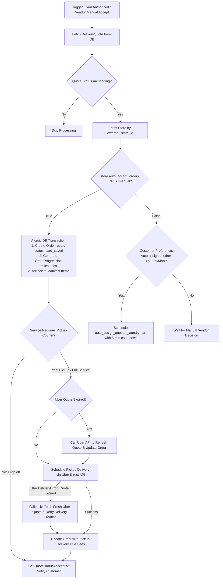

# Payment Module Documentation

The `payment` module is the transactional and financial backbone of LaundryMart. It handles customer payment method tokenization, pre-authorization holds, Stripe Connect onboarding for laundry stores, order creation upon vendor acceptance, automated split payments, platform commissions, instant vendor payouts, and Stripe Connect webhook event processing.

---

## 1. Database Tables & Models

| Model Name | Database Table | Description |
|---|---|---|
| `SavedPaymentMethod` | `payment_savedpaymentmethod` | Stores customer card references tokenized in Stripe (`stripe_payment_method_id`, `card_brand`, `last4`, `exp_month`, `exp_year`, `is_default`). |
| `Order` | `payment_order` | Core order entity tracking total order lifecycle, generated 5-character alphanumeric `uuid`, customer and vendor foreign keys, pricing breakdowns (weight, laundry service charge, delivery fee, platform fee, insurance), and Uber courier delivery IDs. |
| `OrderProgression` | `payment_orderprogression` | Detailed step-by-step milestone checklist for an order (e.g. `Order placed`, `Driver assigned for pickup`, `Laundry received`, `Laundry complete`, `Driver assigned for return`, `Delivered`). |
| `Payment` | `payment_payment` | Historical record of the final captured Stripe PaymentIntent for an order. |
| `PendingStripeOrder` | `payment_pendingstripeorder` | Temporary buffer storing metadata during asynchronous Stripe Checkout or SetupIntent sessions. |
| `LaundrymartPaymentMethod` | `payment_laundrymartpaymentmethod` | External payout bank accounts or debit cards attached to a vendor's Stripe Connect account. |
| `VendorPayout` | `payment_vendorpayout` | Ledger of store earnings and instant payouts initiated to the vendor's Stripe Connect account, tracking `platform_fee`, `added_stripe_fee`, `stripe_payout_id`, and status (`pending`, `paid`, `failed`). |

---

## 2. API Endpoints

### 2.1 Customer Card Management

#### `POST /payment/api/add-card/`
* **Handler**: `add_card_backend`
* **Permissions**: `IsAuthenticated`
* **Description**: Attaches a newly tokenized Stripe PaymentMethod to the authenticated customer in Stripe, marks it as default, and records it in `SavedPaymentMethod`.
* **DB Tables Used**:
  * `payment_savedpaymentmethod` (Insert, Update existing defaults)
  * `accounts_user` (Read, Update Stripe Customer ID)
* **Request Body**:
  ```json
  {
    "payment_method_id": "pm_1NxAbc2eZvKYlo2C"
  }
  ```

#### `GET /payment/api/retrieve-cards/`
* **Handler**: `retrieve_saved_cards`
* **Permissions**: `IsAuthenticated`
* **Description**: Returns the customer's saved credit and debit cards retrieved from Stripe with brand, last 4 digits, expiration dates, and default flags.
* **DB Tables Used**:
  * `payment_savedpaymentmethod` (Read)
  * `accounts_user` (Read)

#### `DELETE /payment/api/delete-card/<str:payment_method_id>`
* **Handler**: `delete_saved_card`
* **Permissions**: `IsAuthenticated`
* **Description**: Detaches the card from the Stripe customer and deletes the corresponding record from `SavedPaymentMethod`.
* **DB Tables Used**:
  * `payment_savedpaymentmethod` (Delete)

#### `GET /payment/api/success/` & `GET /payment/api/cancel/`
* **Handler**: `stripe_success`, `stripe_cancel`
* **Permissions**: `AllowAny`
* **Description**: Callback landing views for Stripe Checkout or SetupIntent redirection flows.

---

### 2.2 Pre-Authorization & Order Placement (Customer API integrations)

#### `POST /customers/api/confirm-order`
* **Handler**: `ConfirmOrderAPIView`
* **Permissions**: `IsCustomer`
* **Description**: Creates a `DeliveryQuote` record in `draft` status, initializes a Stripe customer if not already present, and returns saved cards for selection.
* **DB Tables Used**:
  * `uber_deliveryquote` (Insert)
  * `accounts_user` (Read, Update)

#### `POST /customers/api/charge-by-card`
* **Handler**: `validate_saved_method`
* **Permissions**: `IsCustomer`
* **Description**: Places an off-session pre-authorization hold on the customer's card for the estimated amount + 30% buffer using Stripe `capture_method="manual"`. Upon successful authorization, moves quote status to `pending` and dispatches the acceptance task.
* **DB Tables Used**:
  * `uber_deliveryquote` (Read, Update `validation_status`, `validation_pi_id`, `status='pending'`)
  * `accounts_user` (Read)
* **Background Tasks Triggered**:
  * `payment.tasks.process_acceptance_by_vendor.apply_async(args=[pending_quote_id], countdown=3)`

---

### 2.3 Stripe Connect & Webhooks

#### `POST /webhook/stripe-connect-webhook`
* **Handler**: `stripe_connect_webhook`
* **Permissions**: `AllowAny` (Stripe signature verified)
* **Description**: Listens for Stripe Connect events (e.g. `account.updated`, `payout.paid`, `payout.failed`, `payment_intent.succeeded`). Updates vendor Stripe Connect verification flags (`stripe_connect_status`) and payout statuses in the database.
* **DB Tables Used**:
  * `accounts_user` (Update `stripe_connect_account_status`)
  * `accounts_laundrymartstore` (Update `stripe_connect_status`)
  * `payment_vendorpayout` (Update `status`)

#### Custom Admin Unfold Views (Stripe Connect Onboarding)
* `VendorOnboardingView`: Initiates Stripe Connect account creation and generates Account Link for vendor onboarding.
* `VendorOnboardingRefreshView` / `VendorOnboardingCompleteView`: Handles onboarding return loops.
* `EmbeddedDashboardView`: Renders Stripe Connect embedded components for vendor payout accounts.
* `CreateAccountSessionView`: Issues client secrets for Stripe Account Sessions.

---

## 3. Background Tasks & Fallback Logic

### Celery Task: `process_acceptance_by_vendor`

* **Task Signature**: `@shared_task def process_acceptance_by_vendor(quote_id, is_manual=False)`
* **File Location**: `payment/tasks.py`
* **Triggered by**:
  1. Automated countdown (3 seconds) after successful card hold in `validate_saved_method`.
  2. Manual vendor acceptance in `vendor.views.AcceptQuoteAPIView`.



#### Detailed Execution Steps & Fallback Logic:
1. **Pending Status Validation**: Verifies that `quote.status == 'pending'`. If already accepted, rejected, or canceled, cleanly exits.
2. **Auto-Accept vs Manual Check**:
   * If `store.auto_accept_orders == True` or `is_manual == True`, proceeds immediately with conversion.
   * If `store.auto_accept_orders == False` and not manual, schedules `customer.tasks.auto_assign_another_laundrymart` with an 8-minute countdown (`countdown=480`) as a fallback timeout.
3. **Atomic Order Creation**:
   * Creates `Order` with `status='card_saved'`, links customer and store, sets pre-authorized validation holds, and generates order progression steps (`order.create_progress_steps()`).
4. **Uber Direct Pickup Scheduling & Expiration Fallback**:
   * Checks `quote.expires <= timezone.now()`.
   * **Proactive Quote Refresh**: If the Uber quote expired during the vendor's review period, automatically requests a fresh quote from Uber Direct (`create_pickup_quote` or `create_dropoff_quote`) and updates `quote_id` and fees on both `DeliveryQuote` and `Order`.
   * **Reactive In-Flight Fallback**: If Uber returns an `UberDeliveryError` indicating expiration during delivery creation, catches the exception, requests a new Uber quote, updates the database, and retries `create_and_save_delivery`.
5. **Manifest & Delivery Linking**: Links manifest items to both the `Order` and `Delivery`, associates `uber_pickup_delivery_id`, and transitions `DeliveryQuote.status = 'accepted'`.
