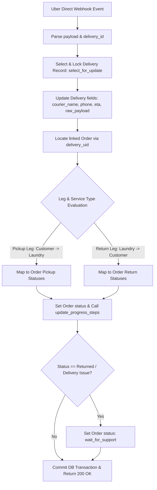

# Uber Module Documentation

The `uber` module manages logistics integration with the **Uber Direct Delivery API**. It handles OAuth2 token management, dynamic quote generation for pickup and dropoff legs, delivery dispatch, real-time courier tracking, item manifests, and real-time webhook ingestion for order lifecycle synchronization.

---

## 1. Database Tables & Models

| Model Name | Database Table | Description |
|---|---|---|
| `DeliveryQuote` | `uber_deliveryquote` | Stores delivery quote details returned by Uber Direct: quote ID, service type (`drop_off`, `pickup`, `full_service`), pickup/dropoff coordinates, fee, duration, estimated dropoff time, expiration time, and Stripe pre-authorization validation fields. |
| `Delivery` | `uber_delivery` | Represents a live courier delivery booked with Uber Direct. Tracks `delivery_uid`, `tracking_url`, courier info (name, phone, vehicle), pickup/dropoff notes, return leg parent references (`parent_delivery`), imminent arrival indicators, and raw Uber webhook payloads. |
| `ManifestItem` | `uber_manifestitem` | Individual laundry bags or items included in a delivery, containing bag size (`small`, `medium`, `large`), weight, dimensions, and declared value for Uber Direct cargo specifications. |

---

## 2. API Endpoints & Webhooks

### 2.1 Delivery Quote Generation

#### `POST /customers/api/get-quote`
* **Handler**: `UberCreateQuoteAPIView`
* **Permissions**: `IsCustomer`
* **Description**: Queries the Uber Direct API to generate a logistics quote for customer delivery requests based on the selected service type:
  * `drop_off`: Laundry transported by customer to laundromat; courier delivers cleaned laundry back to customer.
  * `pickup`: Courier collects laundry from customer and transports to laundromat; customer picks up from laundromat.
  * `full_service`: Dual-leg logistics; courier collects dirty laundry and transports to laundromat, and a second courier delivers clean laundry back to customer.
* **DB Tables Used**:
  * `uber_deliveryquote` (Insert)
  * `uber_manifestitem` (Insert)
* **Request Body**:
  ```json
  {
    "service_type": "full_service",
    "pickup_address": "123 Elm St, Brooklyn, NY",
    "dropoff_address": "789 Atlantic Ave, Brooklyn, NY",
    "pickup_latitude": 40.6782,
    "pickup_longitude": -73.9442,
    "dropoff_latitude": 40.6830,
    "dropoff_longitude": -73.9750,
    "pickup_phone_number": "+1234567890",
    "dropoff_phone_number": "+1987654321",
    "external_store_id": "3fa85f64-5717-4562-b3fc-2c963f66afa6",
    "customer_note": "Gate code is 4321",
    "manifest_items": [
      {
        "name": "Laundry Bag",
        "quantity": 1,
        "size": "large",
        "weight": 22.0,
        "price": 44.00
      }
    ]
  }
  ```
* **Response**: `200 OK` with `quote_id`, `fee`, `expires`, `dropoff_eta`, and route durations.

---

### 2.2 Logistics Status Webhook

#### `POST /webhook/delivery-status`
* **Handler**: `uber_delivery_status_webhook`
* **Permissions**: `AllowAny` (Requires POST, CSRF-exempt)
* **Description**: Receives real-time delivery status updates from Uber Direct. Updates the `Delivery` record and automatically maps Uber courier states to the corresponding `Order.status` and `OrderProgression` milestone.
* **DB Tables Used**:
  * `uber_delivery` (Read with `select_for_update()`, Update)
  * `payment_order` (Read, Update)
  * `payment_orderprogression` (Auto-updated via `Order.update_progress_steps()`)

---

## 3. Webhook Flow & Order Status Mapping

When an Uber Direct webhook event arrives, the system follows this workflow:



### Detailed Status Mapping Rules

#### 1. Pickup Leg (Customer $\rightarrow$ Laundromat)
* `pending` $\rightarrow$ `pickup_courier_scheduled`
* `pickup_false` $\rightarrow$ `pickup_courier_assigned`
* `pickup_true` (courier imminent) $\rightarrow$ `pickup_arriving_soon`
* `pickup_complete` $\rightarrow$ `picked_up_by_courier`
* `dropoff_false` $\rightarrow$ `moving_towards_laundrymart`
* `delivered` $\rightarrow$ `arrived_at_laundry` / `picked_up_by_laundrymart`

#### 2. Return Leg (Laundromat $\rightarrow$ Customer)
* `pending` $\rightarrow$ `return_scheduled`
* `pickup_false` $\rightarrow$ `return_courier_assigned`
* `pickup_true` $\rightarrow$ `return_arriving_soon`
* `pickup_complete` $\rightarrow$ `picked_up_by_courier`
* `dropoff_false` $\rightarrow$ `moving_towards_customer`
* `dropoff_true` $\rightarrow$ `dropping_of_soon`
* `delivered` $\rightarrow$ `completed` / `picked_up_by_customer`

#### 3. Exception & Fallback Mapping
* `canceled` $\rightarrow$ `canceled`
* `returned` (courier unable to access location or deliver) $\rightarrow$ `wait_for_support`

---

## 4. Helper Services & Logistics Fallbacks

* **OAuth2 Token Caching (`uber/cache_access_token.py`)**:
  * Authenticates using Uber Client Credentials (`UBER_CLIENT_ID`, `UBER_CLIENT_SECRET`).
  * Tokens are stored in Redis cache with TTL calculated from `expires_in - 300` seconds buffer.
  * *Fallback*: If cached token is expired or Redis is down, refreshes credentials synchronously and stores in fallback memory.
* **Delivery Creation & Manifest Formatting (`uber/utils.py`)**:
  * Formats bag manifests into required Uber Direct dimensions and pricing structures.
  * Injects `deliverable_action_meet_at_door` or `deliverable_action_leave_at_door`.
* **Expired Quote Recovery**:
  * In `payment.tasks.process_acceptance_by_vendor`, if a quote expires before courier booking, Uber Direct is re-queried for updated rates without dropping the customer's order.
