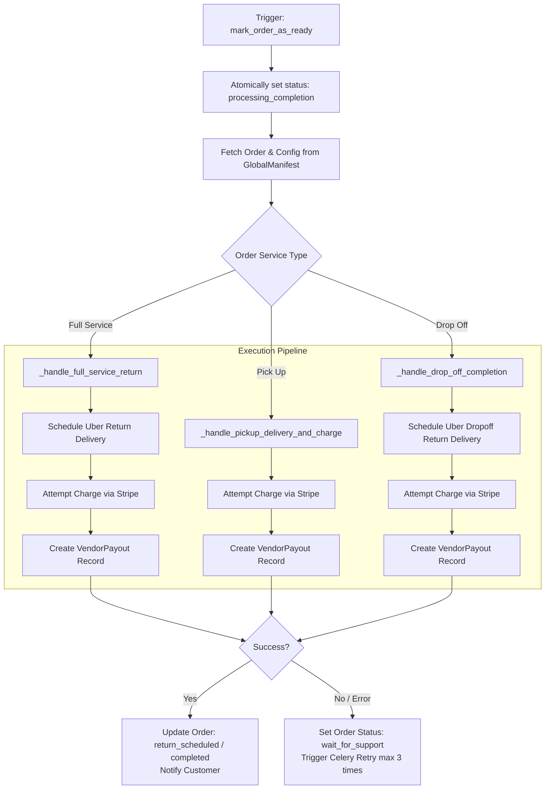

# Vendor Module Documentation

The `vendor` module provides the operations portal and API for laundry store owners and store staff. It handles incoming order offer acceptance/rejection, weighing and price calculation, laundry lifecycle state management, dashboard analytics, sales reporting, and the order completion background pipeline.

---

## 1. Database Tables & Models

| Model Name | Database Table | Description |
|---|---|---|
| `OrderReport` | `vendor_orderreport` | Store-filed issue reports regarding order discrepancies, logistics delays, or customer disputes. |
| `OrderReportImage` | `vendor_orderreportimage` | Supporting photographic evidence attached to vendor issue reports. |
| `OrderTrack` | *(Proxy for `Order`)* | Proxy model for admin monitoring of active order pipelines. |
| `VendorDashboard` | `vendor_vendordashboard` | Admin marker model for vendor analytics dashboards. |

### Related Models Queried / Modified by Vendor APIs
* `accounts_laundrymartstore` (`LaundrymartStore`) - Store settings, pricing, operating hours.
* `accounts_employee` (`Employee`) - Staff credentials and store association.
* `payment_order` (`Order`) - Orders being processed, weight, status, totals.
* `payment_vendorpayout` (`VendorPayout`) - Payout ledger records generated upon order completion.
* `uber_deliveryquote` (`DeliveryQuote`) - Quotes offered to the vendor.
* `uber_delivery` (`Delivery`) - Uber logistics tracking for return deliveries.

---

## 2. API Endpoints

All vendor endpoints are mounted under `/vendor/api/`.

### 2.1 Order Ingestion & Decision Making

#### `PATCH /vendor/api/accept/<int:quote_id>`
* **Handler**: `AcceptQuoteAPIView`
* **Permissions**: `IsEmployee`
* **Description**: Accepts a pending delivery quote. Checks if the quote is within the 9-minute validity window. If expired, marks quote status as `delayed`. If valid, triggers the background acceptance pipeline via `process_acceptance_by_vendor.delay(quote.id, is_manual=True)`.
* **DB Tables Used**:
  * `uber_deliveryquote` (Read, Update)
  * `accounts_employee` (Read)
  * `accounts_laundrymartstore` (Read)
* **Background Tasks Triggered**:
  * `payment.tasks.process_acceptance_by_vendor.delay(quote.id, is_manual=True)` (enqueued on database transaction commit)
* **Response**: `200 OK` with quote acceptance confirmation.

#### `PATCH /vendor/api/reject/<int:quote_id>`
* **Handler**: `RejectQuoteAPIView`
* **Permissions**: `IsEmployee`
* **Description**: Rejects an offered quote. Transitions `DeliveryQuote.status = 'rejected'`, notifies the customer via push notification, and checks customer preference. If preference is set to auto-assign, immediately triggers `auto_assign_another_laundrymart.delay`.
* **DB Tables Used**:
  * `uber_deliveryquote` (Read, Update)
  * `accounts_user` (Read)
* **Background Tasks Triggered**:
  * `customer.tasks.auto_assign_another_laundrymart.delay(quote.id, UBER_CUSTOMER_ID)`
* **Response**: `200 OK` indicating quote rejection.

---

### 2.2 Store Operations & Order Status Transitions

#### `PATCH /vendor/api/order-received/<int:order_id>`
* **Handler**: `mark_order_as_received`
* **Permissions**: `IsEmployee`
* **Description**: Executed by the store when laundry arrives at the laundromat. Updates `Order.status = 'received'`, triggers push notification to customer, and automatically advances `OrderProgression`.
* **DB Tables Used**:
  * `payment_order` (Read, Update)
  * `payment_orderprogression` (Update milestone to complete)

#### `PATCH /vendor/api/order-weighed/<int:order_id>`
* **Handler**: `save_final_order_weight`
* **Permissions**: `IsEmployee`
* **Description**: Vendor records the actual measured weight in pounds after receiving laundry. Recalculates `service_charge_cents`, sets `Order.status = 'weighed'`, and dispatches `customer_receive_order_weighed_notification`.
* **DB Tables Used**:
  * `payment_order` (Read, Update)
* **Request Body**:
  ```json
  {
    "weight_in_pounds": 18.5,
    "service_charge_cents": 3700
  }
  ```

#### `PATCH /vendor/api/mark_as_ready/<int:order_id>`
* **Handler**: `mark_order_as_ready`
* **Permissions**: `IsEmployee`
* **Description**: Marks the laundry as washed, dried, and ready. Atomically moves `Order.status` from `'weighed'` to `'processing_completion'` to avoid duplicate execution, then enqueues `process_order_completion.delay(order.id)`.
* **DB Tables Used**:
  * `payment_order` (Read, Update)
* **Background Tasks Triggered**:
  * `vendor.tasks.process_order_completion.delay(order.id)`
* **Response**: `202 Accepted` indicating background processing has started.

#### `PATCH /vendor/api/mark_as_completed/<int:order_id>`
* **Handler**: `mark_order_as_completed`
* **Permissions**: `IsEmployee`
* **Description**: Finalizes a Pick Up order once the customer picks up the laundry directly from the store. Transitions `Order.status = 'completed'` and sets `completed_at`.
* **DB Tables Used**:
  * `payment_order` (Read, Update)

---

### 2.3 Dashboard & Order Lists

#### `GET /vendor/api/dashboard`
* **Handler**: `DashboardAPIView`
* **Permissions**: `IsEmployee`
* **Description**: Returns comprehensive analytics for the vendor's store: total orders, daily orders for past 7 days, monthly revenue, active vs pending quotes, and operational capacity.
* **DB Tables Used**:
  * `payment_order` (Read, Aggregates)
  * `uber_deliveryquote` (Read)
  * `accounts_laundrymartstore` (Read)

#### `GET /vendor/api/order-list`
* **Handler**: `VendorOrdersListAPIView`
* **Permissions**: `IsEmployee`
* **Description**: Paginated list of vendor orders with filters for `pending_quotes`, `active`, and `completed`.
* **DB Tables Used**:
  * `payment_order` (Read)
  * `uber_deliveryquote` (Read)

#### `GET /vendor/api/order-detail/<str:type>/<int:id>`
* **Handler**: `VendorOrderDetailAPIView`
* **Permissions**: `IsEmployee`
* **Description**: Fetches granular order or quote details including customer information, items, addresses, and delivery status. `<str:type>` can be `order` or `quote`.
* **DB Tables Used**:
  * `payment_order` / `uber_deliveryquote` (Read)

#### `GET /vendor/api/sales-report/<int:user_id>/`
* **Handler**: `VendorSalesSummaryAPI`
* **Permissions**: `IsEmployee`
* **Description**: Generates financial summaries of completed orders, net payouts, platform fees, and gross volume grouped by date range.
* **DB Tables Used**:
  * `payment_order` (Read)
  * `payment_vendorpayout` (Read)

#### `POST` / `GET /vendor/api/order-report`
* **Handler**: `VendorOrderReportAPIView`
* **Permissions**: `IsEmployee`
* **Description**: Submits or lists vendor incident reports concerning specific orders or delivery quotes.
* **DB Tables Used**:
  * `vendor_orderreport` (Insert, Read)
  * `vendor_orderreportimage` (Insert)

#### `GET /vendor/api/global-manifest`
* **Handler**: `VendorGlobalManifestAPIView`
* **Permissions**: `AllowAny`
* **Description**: Retrieves vendor platform configuration (pricing rules, terms, policies) from Redis cache.
* **DB Tables Used**:
  * Redis Cache (`vendor_global_manifest_data`) with fallback to `admin_panel_globalmanifest`.

---

## 3. Background Tasks & Fallback Logic

### Celery Task: `process_order_completion`

* **Task Signature**: `@shared_task(bind=True, max_retries=3, default_retry_delay=30) def process_order_completion(self, order_id: int)`
* **File Location**: `vendor/tasks.py`
* **Triggered by**: `mark_order_as_ready` endpoint.



#### Detailed Execution Steps & Fallback Logic:
1. **Idempotency Guard**:
   * If `order.status in ['return_scheduled', 'completed', 'charged']`, skips execution immediately to prevent double charges or duplicate courier bookings.
2. **Platform & Stripe Fee Calculation**:
   * Dynamically loads platform fee percentage and transaction added cents from `GlobalManifest` cache.
3. **Execution by Service Type**:
   * **Full Service (`_handle_full_service_return`)**:
     * Creates return delivery with Uber Direct (`create_and_save_delivery`) from store to customer.
     * Charges the customer's saved payment method via Stripe PaymentIntent for: `(service_charge + delivery_fee + platform_fee + insurance)`.
     * Calculates vendor net share and records a `VendorPayout` row with status `pending`.
   * **Pick Up (`_handle_pickup_delivery_and_charge`)**:
     * Charges customer for laundry processing and platform fee.
     * Generates `VendorPayout`.
   * **Drop Off (`_handle_drop_off_completion`)**:
     * Schedules the return Uber courier leg to customer.
     * Charges customer for laundry and return delivery.
4. **Fallback & Recovery Handling**:
   * **Charge / Uber Booking Failure**: If Uber rejects the delivery request or Stripe declines the off-session charge, `Order.status` is set to `'wait_for_support'`.
   * **Celery Retry**: Unhandled exceptions trigger `raise self.retry(exc=exc)` (retries up to 3 times with 30-second exponential delay) before notifying operations.
